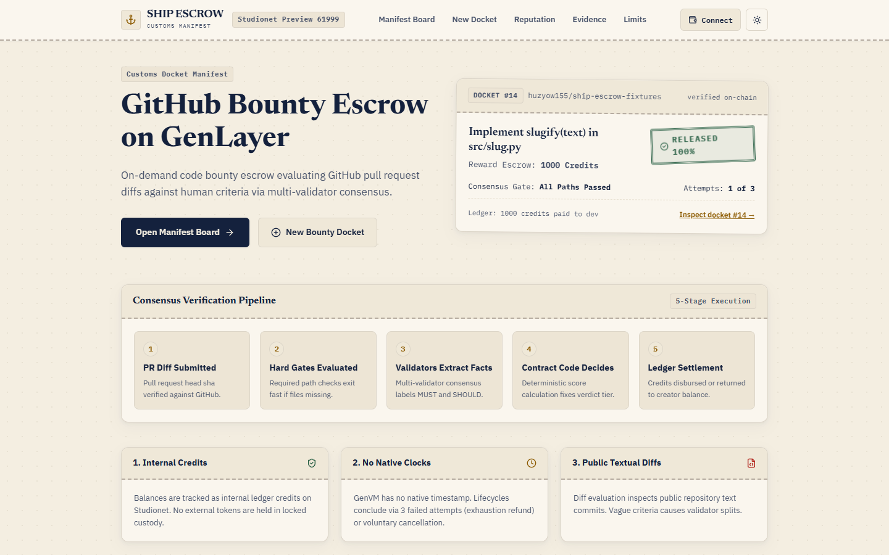

# Ship Escrow DApp

Web app (Preview): https://ship-escrow-app.vercel.app  
Contract repository: https://github.com/huzyow155/ship-escrow-genlayer  
Fixtures repository: https://github.com/huzyow155/ship-escrow-fixtures  



Web app for GitHub PR bounties on GenLayer Studionet (Preview). Credits are tracked in a contract ledger; no tokens are locked.

Contracts deployed on **GenLayer Studionet Preview**:
- **ShipEscrow**: [`0x8DC94110Ed3E111Fb74Dce849CdBA8f567E6024F`](https://explorer-studio.genlayer.com/address/0x8DC94110Ed3E111Fb74Dce849CdBA8f567E6024F)
- **ShipReputation**: [`0x55c56f0dfFb8227345814A37c68394b05c26E901`](https://explorer-studio.genlayer.com/address/0x55c56f0dfFb8227345814A37c68394b05c26E901)
- **Contract Repository**: [huzyow155/ship-escrow-genlayer](https://github.com/huzyow155/ship-escrow-genlayer)
- **Fixtures Repository**: [huzyow155/ship-escrow-fixtures](https://github.com/huzyow155/ship-escrow-fixtures)

---

## Architecture & Visual Identity

Ship Escrow uses a "bounty manifest" and invoice docket visual aesthetic:
- Distinct maritime manifest layout with high-contrast stamps for verdicts (`RELEASE_100`, `RELEASE_75`, `RELEASE_50`, `RELEASE_25`, `REVIEW`, `REFUND`).
- Full dark and light theme support.
- Zero-wallet read support with zero console errors.
- axe: 0 serious or critical violations on 7 routes (automated check only).
- Compact word budget: Landing page at most 160 words, each application view at most 40 words.

---

## Getting Started

### Prerequisites
- Node.js >= 18
- npm

### Installation
```bash
npm install
```

### Development
```bash
npm run dev
```

### Production Build
```bash
npm run build
```

### Running Tests
```bash
npm test
```
The test suite validates:
1. Exact SHA-256 integrity of reference contracts against deployed source hashes.
2. Complete catalog mapping of all 49 UserError raises in Python contracts.
3. Pure TypeScript criteria hash computation against on-chain view output.
4. 5,000-case fuzz verification of the `decide()` scoring function against an independent oracle.

### End-to-end script
Run the automated end-to-end flow using throwaway accounts on Studionet:
```bash
node scripts/e2e.mjs
```

### Manual Verification
Follow the 8-step manual testing guide in [MANUAL_METAMASK_TEST.md](MANUAL_METAMASK_TEST.md).

---

## License

MIT License • Copyright (c) 2026 Hyper (huzyow155).
